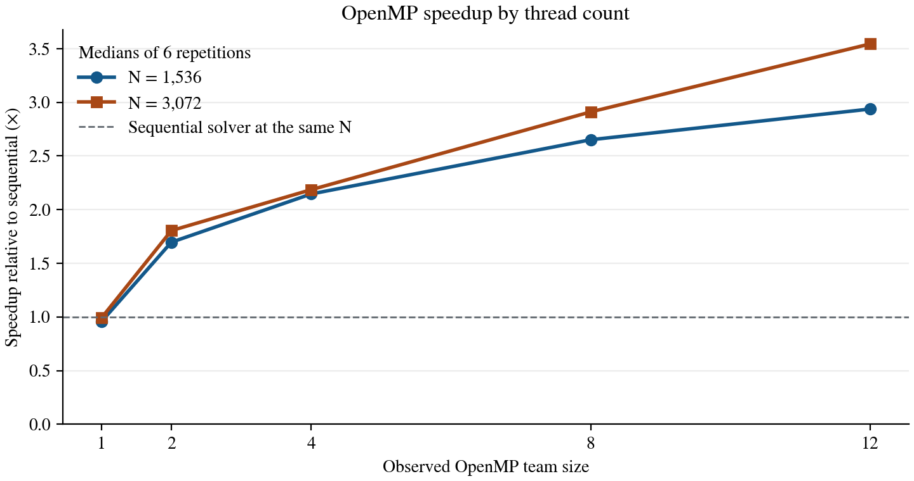
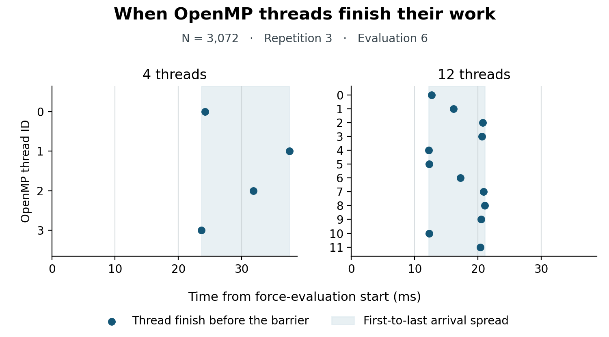
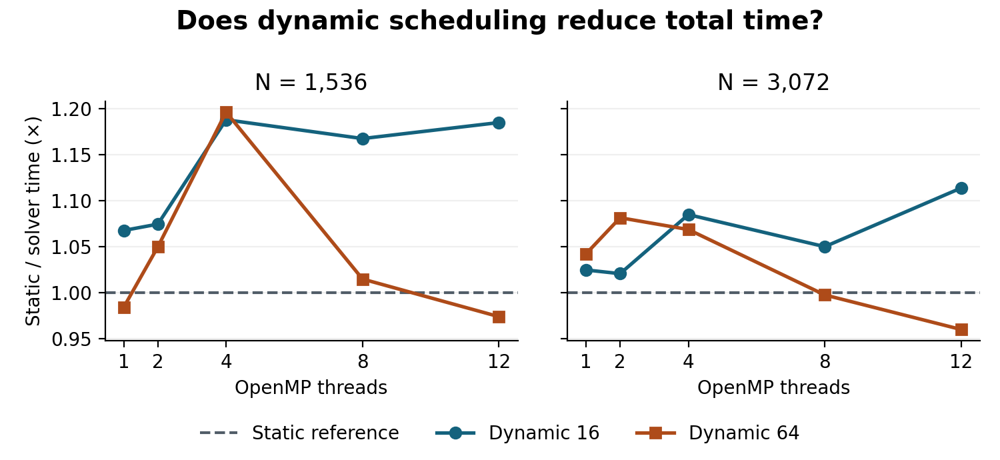

# Optimizing N-Body Simulation

Implementation, profiling, and optimization of direct 3D N-body simulations in C++20 with OpenMP.

The sequential reference, static OpenMP baseline and dynamic OpenMP solvers share one direct gravity kernel and one Velocity Verlet integrator. On the provisional 3,072-body input, 16-target chunks reduced median simulation time by 10.2% against static scheduling at 12 threads. [Semester report](report/Phillipe_BAGUEKA_NBody_OpenMP_Report.pdf)

## Objectives

- Develop a solid understanding of parallel programming, modern C++, and algorithmic complexity.
- Understand the gravitational model and numerical integration sufficiently to implement and validate it.
- Compare a sequential reference, an initial OpenMP implementation, and a profiling-driven optimized OpenMP implementation.
- Explain performance improvements and limitations using reproducible measurements.
- Build an interactive visualization of trajectories produced by the C++ engine.
- Write the semester report progressively in LaTeX and deliver the compiled PDF.

## Assignment constraints

- Model a three-dimensional system with mass, position, and velocity for each body.
- Compute gravitational accelerations using a documented softening parameter.
- Evaluate all accelerations from a complete same-time position state. In Velocity Verlet, compute the initial accelerations, update all positions, recompute all accelerations, then update all velocities.
- Use a fixed time step and the same integration scheme in all compared implementations.
- Keep the direct O(N^2) interaction algorithm in the assessed optimization work.
- Validate parallel positions and velocities against the sequential reference using a predefined numerical tolerance.
- Demonstrate the sequence: measurement, profiling, identified bottleneck, targeted optimization, and repeated measurement.
- Report speedup and parallel efficiency relative to the sequential reference.

CUDA and Barnes-Hut are possible future extensions. They are outside the initial implementation plan; Barnes-Hut does not replace the required direct algorithm.

## Roadmap

The [detailed roadmap](docs/roadmap.md) defines the learning tasks, implementation work, and completion criteria for each milestone.

| Milestone | Deliverable |
| --- | --- |
| 0 | Repository and a working local C++20/OpenMP build environment |
| 1 | Physical model, numerical method, and complexity analysis |
| 2 | Reproducible initial conditions and a verified sequential reference |
| 3 | A verified baseline OpenMP implementation |
| 4 | Profiling evidence and targeted, validated optimization |
| 5 | Reproducible experiments, notebooks, tables, and plots |
| 6 | Interactive visualization and a results dashboard |
| 7 | Final report, reproducible submission archive, and defense preparation |

The report and learning record evolve throughout the milestones.

## Learning workflow

For each substantial concept: explanation, prediction, a focused learner implementation, verification, and explanation in the learner's own words.

Core exercises are reserved for the learner. Codex may implement agreed supporting work or a bounded code change when faster progress is requested. Generated code is then reviewed, predicted, tested, and explained.

Conversation and coaching are in French. Code identifiers, public technical documentation, and the report are in English.

## Performance results

### OpenMP speedup by thread count



Using median times from six repetitions and the sequential solver of the same size as the reference, 12 threads reached 2.94× speedup for 1,536 bodies and 3.54× for 3,072. [Raw timing CSV](results/baseline/raw.csv) · [Figure reproduction script](benchmarks/analyze.py)

### When OpenMP threads finish their work



Each point marks one thread finishing its assigned targets before the barrier. In repetition 3, evaluation 6, equal target counts within each team still produced first-to-last spreads of 13.90 ms at four threads and 8.83 ms at twelve. [Raw arrival CSV](results/arrivals/raw.csv) · [Figure reproduction script](benchmarks/analyze.py) · [All evaluation spreads](results/arrivals/spreads.csv)

### Does dynamic scheduling reduce total time?



At 3,072 bodies and 12 threads, 16-target chunks reduced the pooled median from 145.18 to 130.36 ms, winning five of six matched rounds in each pass. The pooled 64-target median was 151.20 ms. [Timing CSV A](results/optimization/pass-a/raw.csv) · [Timing CSV B](results/optimization/pass-b/raw.csv) · [Reproduction script](benchmarks/analyze_optimization.py)

| Solver at 3,072 bodies | Threads | Median (ms) | IQR (ms) | Speedup vs sequential | Efficiency | Static / solver |
| --- | ---: | ---: | ---: | ---: | ---: | ---: |
| Sequential | 1 | 509.62 | 210.27 | 1.00 | 100.0% | — |
| Static | 12 | 145.18 | 56.83 | 3.51 | 29.3% | 1.000 |
| Dynamic 16 | 12 | 130.36 | 34.73 | 3.91 | 32.6% | 1.114 |
| Dynamic 64 | 12 | 151.20 | 49.53 | 3.37 | 28.1% | 0.960 |

Each row pools 12 unprofiled runs. Ratios divide medians within the same size and pass or pool. A ratio above 1 favors the variant. The primary case required a lower median and at least five paired wins in six rounds in **each** pass. Dynamic 16 achieved 1.092× in pass A and 1.177× in B. Dynamic 64 won four rounds then three. Its individual pass medians were lower than static, but pooling the observations reversed their order. Pass B's static IQR was 195.41 ms, compared with 16.82 ms in A. The differences do not identify a particular OS or hardware cause. [All configurations and paired wins](results/optimization/summary.csv)

In the independent trace, median arrival spreads at four threads were 11.79, 0.44 and 1.18 ms for static, dynamic 16 and dynamic 64. At twelve threads they were 6.21, 0.81 and 3.28 ms. Every evaluation covered all 3,072 targets. A shorter spread can coexist with a longer simulation. [Raw worker data](results/optimization/arrivals/raw.csv) · [Per-evaluation spreads](results/optimization/arrival-spreads.csv) · [Trace summary](results/optimization/arrival-summary.csv)

## Reproducibility

Use the Windows UCRT64 builds below and native Python 3.11+ with Matplotlib (3.9.2 for the archived figures). Each timing pass uses a fresh process per size, one checked warm-up per configuration, six measured rounds and the true sequential solver. The second pass reverses size and team order. Each round rotates the starting configuration and alternates traversal direction in the scheduling comparison. Every candidate is compared component by component with the checked sequential state. The arrival experiment runs separately.

From the repository or extracted archive root in PowerShell, start with empty output directories under `build`. The generator in `benchmarks/benchmark.cpp` uses `std::mt19937_64` with seed 20261117. Each draw converts the upper 53 bits to a number in [0,1). Each body draws mass in [0.5,1.5), then three positions in [−1,1), then three velocities in [−0.1,0.1). All runs use G = 1, epsilon = 0.05 and dt = 0.0005 in normalized units.

```powershell
$env:Path = 'C:\msys64\ucrt64\bin;' + $env:Path
python benchmarks/run_campaign.py --sizes 1536 3072 --output build/repeat-baseline
python benchmarks/run_campaign.py --arrivals --sizes 3072 --threads 4 12 --output build/repeat-arrivals
python benchmarks/run_campaign.py --compare --no-states --sizes 1536 3072 --threads 1 2 4 8 12 --output build/compare/pass-a
python benchmarks/run_campaign.py --compare --no-states --sizes 3072 1536 --threads 12 8 4 2 1 --output build/compare/pass-b
python benchmarks/run_campaign.py --schedule-arrivals --sizes 3072 --threads 4 12 --output build/compare/arrivals
python benchmarks/analyze_optimization.py build/compare
```

To redraw the published figures and LaTeX tables directly from the archived CSVs, run:

```powershell
python benchmarks/analyze.py results/baseline/raw.csv --arrivals results/arrivals/raw.csv
python benchmarks/analyze_optimization.py results/optimization
```

The [baseline protocol](docs/baseline-performance.md) gives the profiling, replay and original build commands. The profiler requires psutil, MSYS2's `profiler` and UCRT64 binutils. The preserved histogram and detached symbols allow the original capture to be reread.

## Milestone 0 build check

The original `openmp_smoke_check` executable is retained alongside the simulator. Run the following commands from an MSYS2 UCRT64 shell:

```bash
cmake --preset ucrt64-debug
cmake --build --preset ucrt64-debug
ctest --preset ucrt64-debug
./build/ucrt64-debug/openmp_smoke_check.exe
```

Use the Release preset to verify an optimized build:

```bash
cmake --preset ucrt64-release
cmake --build --preset ucrt64-release
ctest --preset ucrt64-release
./build/ucrt64-release/openmp_smoke_check.exe
```

Debug keeps information useful to GDB. Release enables compiler optimizations and is the appropriate starting point for later performance measurements.

Start an interactive debugging session with the Debug executable:

```bash
gdb ./build/ucrt64-debug/openmp_smoke_check.exe
```

The verified local toolchain and machine details are recorded in [docs/development-environment.md](docs/development-environment.md).

## Simulation and validation

`nbody::Vec3` provides the vector arithmetic. `Body` stores mass, position and velocity. Bodies and accelerations occupy separate vectors. All solvers share the contribution calculation and source order. A single Velocity Verlet driver selects the target schedule through an enum.

After building, run the supplied two-body arithmetic reference and the four-body example:

```bash
./build/ucrt64-release/nbody_demo.exe --solver sequential --case two-body --steps 1 --dt 0.5
./build/ucrt64-release/nbody_demo.exe --solver openmp --case two-body --steps 1 --dt 0.5 --threads 4 --diagnostics
./build/ucrt64-release/nbody_demo.exe --solver sequential --case multi-body --steps 25 --dt 0.01
./build/ucrt64-release/nbody_demo.exe --solver openmp --case multi-body --steps 25 --dt 0.01 --threads 4 --diagnostics
./build/ucrt64-release/nbody_demo.exe --solver dynamic16 --case multi-body --steps 25 --dt 0.01 --threads 4 --diagnostics
./build/ucrt64-release/nbody_demo.exe --solver dynamic64 --case multi-body --steps 25 --dt 0.01 --threads 4 --diagnostics
```

`--help` lists options. Defaults are sequential, two-body, 10 steps, `dt=0.01`, and one requested OpenMP thread. The optional `--diagnostics` reports the team size observed inside the last force evaluation. It is disabled by default. `--threads` is accepted only in OpenMP mode; the runtime can limit the actual team size. Output uses 17 significant digits and includes parameters and initial/final states.

`ctest --preset ucrt64-debug` and `ctest --preset ucrt64-release` execute 12 checks, including the physical reference, final-state equivalence, zero steps, partial chunks and the pre-barrier traces. Tests remain active in Release. To see the observed 1/2/4-thread teams, use `ctest --preset ucrt64-release -R simulation_tests -V`.

See [model, inputs, contracts and validation](docs/model-and-validation.md) for the complete provisional cases, units, exact reference constants, input validation, and numerical limitations. With `K` steps, the integrator performs `K + 1` complete force evaluations, including initialization, and uses linear storage without an interaction matrix.

For the report, run from the repository root with an existing LaTeX installation:

```bash
pdflatex -interaction=nonstopmode -halt-on-error -jobname=Phillipe_BAGUEKA_NBody_OpenMP_Report -output-directory=report report/main.tex
pdflatex -interaction=nonstopmode -halt-on-error -jobname=Phillipe_BAGUEKA_NBody_OpenMP_Report -output-directory=report report/main.tex
```

The [compiled report](report/Phillipe_BAGUEKA_NBody_OpenMP_Report.pdf) has ten A4 pages including its cover. The two dependency diagrams are on pages 3 and 4, and the comparative timing results are on page 9.

## Submission

| Assignment requirement | Evidence in this submission |
| --- | --- |
| Direct 3D gravity with softening | [Body representation](include/nbody/body.hpp), [force law and inner source loop](src/gravity.cpp) |
| Comparable sequential, static and optimized implementations | [Solver selection](include/nbody/simulation.hpp), [static and dynamic target loops](src/gravity.cpp) |
| Same step and complete position state | [Shared Velocity Verlet driver](src/simulation.cpp), [benchmark input constants and generator](benchmarks/benchmark.cpp) |
| Profile motivates the scheduling experiment | [Capture](results/profile/capture.json), [resolved instructions](results/profile/symbols.csv), [original static arrival trace](results/arrivals/raw.csv) |
| Positions and velocities checked against sequential | [Acceptance rule and comparison for every run](benchmarks/benchmark.cpp), [physical and edge-case tests](tests/simulation_tests.cpp) |
| Repeated measurements, speedup and efficiency | [Matched timings and dispersion for every configuration](results/optimization/summary.csv), [analysis](benchmarks/analyze_optimization.py) |
| Reproducible data and status of the individual variant | [Generation procedure](#reproducibility), [build and run metadata](results/optimization/pass-a/metadata.json), report page 2 |

The [Moodle archive on GitHub](https://github.com/phillipe-BAGUEKA/optimizing-nbody-simulation/blob/main/Phillipe_BAGUEKA_NBody_OpenMP_Project.zip) includes the report, C++ and LaTeX sources, CMake presets, tests, generators, scripts, plots and raw measurements. Extract it, then run the build, test, simulation and figure commands above from the extracted root. From a Git checkout, recreate the source archive with `git -c core.autocrlf=false archive --format=zip --output=build/Phillipe_BAGUEKA_NBody_OpenMP_Project.zip HEAD` after configuring a build directory. This preserves the source line endings used for the recorded checksums.

The individual assignment lists which parameters are fixed, but the supplied materials did not give this student's values. Confirm both sizes, the step count, seed, ranges, G, epsilon and dt above. If the assigned tuple differs, regenerate the inputs and rerun numerical comparisons, baseline timings and profile, arrival diagnostics, both timing passes and the report. The course materials suggest approximately 12–18 pages of main text; the supplied short report has nine pages of main text.

The working submission target is **14 December 2026**, the earlier date in the supplied assignment material. The Moodle entry and Lecture 1 mention 16 December; the definitive date and topic-registration status still need confirmation.

## References

- [NVIDIA: Fast N-Body Simulation with CUDA](https://developer.nvidia.com/gpugems/gpugems3/part-v-physics-simulation/chapter-31-fast-n-body-simulation-cuda)
- [Intel: Direct N-body Simulation](https://www.intel.com/content/www/us/en/developer/articles/technical/direct-n-body-simulation.html)
- [OpenMP specifications](https://www.openmp.org/specifications/)
- [NASA/JPL Horizons manual](https://ssd.jpl.nasa.gov/horizons/manual.html)
- [REBOUND: a self-gravitating Plummer sphere](https://rebound.hanno-rein.de/c_examples/selfgravity_plummer/)
